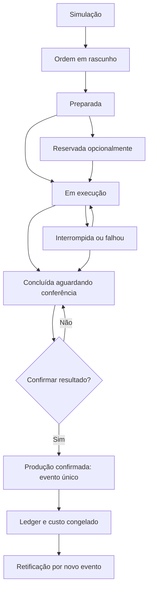

# MakerCusto — Produção real, reservas, falhas, retrabalho e rateio de mesas mistas

**Estado: PROPOSTA DE ARQUITETURA NÃO HOMOLOGADA.** Revisão documental da branch `feat/fundacao-makercusto` com base exata no commit `ca53d01c2a987af06bdf26e76e39fe871d6fa83d`, em 20/11/2026. Nenhum código, banco, SQL, migração, merge ou deploy autorizado/executado.

Fontes: `AGENTS.md`, `CONTINUIDADE.md`, `PLANO_MESTRE_MAKERCUSTO.md`, `MODELO_DE_DADOS.md`, `CONTRATO_ESTOQUE_PRODUTOS.md`, `REFINAMENTO_ESTOQUE_PRODUCAO.md`, `HOMOLOGACAO_ESTOQUE_2026-11-20.md` e demais homologações.

## 1. Regras HOMOLOGADAS preservadas — 23 no total

**5 estruturais:** G original protegido por cópia renomeável; leitura e autoria de catálogo Compartilhado; Full privado por padrão com publicação de cópia; estoque rastreável de matérias-primas, itens comprados e acabados; kits multicomponentes com ferramentas e montagem.

**8 de acesso/ciclo:** rascunhos privados até publicar; downgrade preserva propriedade/privacidade e restringe novas ações pagas; somente ficha descritiva publicável; cópias versionadas com origem; gratuito sem leitura de S inicialmente; prever `workspace_id`; custo real do lote preferencial e snapshot imutável; manutenção de G só pela administração.

**4 técnicas:** tabelas próprias por espécie de catálogo; impressora física diferente de modelo; tarifa elétrica da oficina; definição de filamento diferente de compra e bobina/lote.

**6 de estoque/produção:** identidade estocável por oficina; bloqueio de saldo negativo por padrão; **baixa somente na confirmação de produção**; kit/BOM versionado; **rateio explícito** para saídas diferentes da mesma mesa sem fórmula fixada; estorno auditável.

**Consequência:** todas as regras abaixo sobre reserva, confirmação parcial, custo da falha, algoritmo de rateio e cancelamento são PROPOSTAS. Não atribuir sua homologação ao usuário.

## 2. Terminologia e separações necessárias

- **Simulação/orçamento:** cálculo sem comprometer nem baixar estoque.
- **Ordem de produção:** planejamento de itens/quantidades/mesa. Sua criação não confirma fabricação.
- **Reserva:** compromisso lógico futuro proposto; **não** é movimento físico de consumo.
- **Execução (run):** operação real de impressão, com impressora, início, fim e medidas; pode conter vários produtos.
- **Confirmação:** autorização explícita e idempotente que contabiliza o consumo real, entradas de produtos acabados e snapshot, sem baixa antecipada.
- **Consumo físico medido:** gramas efetivamente gastas; distinguir modelo, purga e perdas. Se peso de relatório do slicer já inclui purga, não somá-la.
- **Falha/refugo:** material gasto sem saída aprovada; não fabricar estoque de produto bom.
- **Retrabalho:** nova operação vinculada à execução ou saída original, com material/tempo/custo próprios.
- **Mesa mista:** execução única com saídas de produtos/revisões diferentes, que requer rateio por categoria conciliado.
- **Custo estimado vs custo realizado:** preservar ambos, sem tratar estimativa de potência ou peso como medição.

## 3. Máquina de estados PROPOSTA — sem reabrir baixa homologada

**Homologado:** rascunho, simulação, reserva e início da execução **não geram baixa de estoque**; a baixa acontece na confirmação da produção. **Em aberto:** se, após falha, é possível confirmar apenas desperdício sem produto acabado; nomenclatura e regras da confirmação parcial.

Proposta de segurança: em vez de permitir mutação de `confirmed` de volta para `draft`, registrar eventos de retificação/estorno e novo resultado confirmado, preservando trilha.

## 4. Reservas de materiais — PROPOSTA

### 4.1 Entidades de reserva

| Entidade | Campos lógicos propostos | Invariante |
|---|---|---|
| `production_orders` | id, workspace_id, product_revision_id, planned_qty, status, created_by | planejamento não é fabricação |
| `production_reservations` | id, order_id, inventory_item_id, lot_id?, location_id?, qty_base, status, expires_at?, created_at | compromisso próprio da oficina; não movimento de consumo |
| `reservation_events` | id, reservation_id, delta_reserved_base, reason, actor_id, created_at | trilha da reserva/liberação, sem apagar origem |
| `reservation_links` | reservation_id, confirmation_event_id, consumed_qty_base | concilia liberação ao confirmar baixa |

**Fórmulas propostas, não homologadas:** `saldo_fisico = SOMA(movimentos)`; `saldo_reservado_ativo = SOMA(reservas validas)`; `saldo_disponivel = saldo_fisico - saldo_reservado_ativo`. Reserva não reduz o físico; ao confirmar, o consumo baixa físico e libera/consome a parcela reservada **na mesma transação**, impedindo dupla subtração. Não reservar a mesma quantidade simultaneamente para duas ordens sem saldo suficiente.

**Bloqueio já homologado:** nenhuma operação ordinária pode causar saldo disponível negativo. A política de reserva, vencimento, prioridade, remanejamento, cancelamento e exceções precisa de homologação adicional.

**Concorrência proposta:** reserva e confirmação devem serializar/validar saldo por `workspace_id + item_id + lot_id + location_id`, pois duas sessões podem operar simultaneamente; validar só no navegador é insuficiente.

### 4.2 Casos-limite

- Reserva 100 g e saldo físico 120 g: disponível proposto 20 g, físico segue 120 g.
- Cancelar reserva libera 100 g sem entrada fictícia no ledger.
- Consumir 90 g da reserva de 100 g: baixa 90 g e libera 90 g de reserva; 10 g restantes continuam reservados ou são liberados conforme decisão da ordem.
- Estorno de baixa após encerramento de reserva não deve recriar automaticamente uma reserva antiga.
- Sem lote identificado: calcular custo estimado sem movimentar lote fictício; regra de consumir sem lote ainda pendente.

## 5. Produção parcial, cancelamento, falha e retrabalho — PROPOSTA

### 5.1 Confirmação parcial

**Proposta:** uma `production_run` pode ter várias `production_confirmations` (`sequence_no` único, `idempotency_key` única, `status=confirmed`), cada uma contabilizando **apenas o incremento ainda não confirmado** de consumo e saída. O motor registra total acumulado, impedindo repetir os mesmos gramas ou unidades. Isso preserva a regra homologada: só a confirmação faz baixa, mesmo que seja parcial.

**Alternativa ainda não decidida:** permitir somente confirmação final por execução e representar cada etapa parcial como `production_run` separada. Escolher antes do SQL.

### 5.2 Falhas reais

Casos operacionais que devem ser modeláveis (a classificação é proposta, não evento observado):
- **Falha antes de extrusão relevante:** saída boa 0, consumo 0 ou consumo medido, duração real registrada; custo elétrico e máquina só se aplicam se houve uso real estimado/medido.
- **Falha após gastar filamento:** saída boa 0, material consumido/perdido registrado; não gerar produto acabado artificial.
- **Falha parcial em mesa mista:** quantidades boas e rejeitadas por produto; repartir custos e perdas segundo política explícita, sem atribuir toda perda a peças boas automaticamente.
- **Pausa/retomada:** registrar tempos ativo, pausa e total transcorrido em campos distintos. Horas de operação de impressora não podem ser inferidas apenas de início e fim quando houve pausa.

**Proposta financeira:** custo da falha fica em categoria rastreável `loss/rework`, opcionalmente transferível a unidades boas conforme decisão comercial futura; não chamá-lo automaticamente de custo por peça boa.

### 5.3 Retrabalho

Nova `rework_runs` (ou `production_runs.parent_run_id` + `run_kind=rework`) aponta execução/saída de origem; tem consumo, tempo, ferramentas e aprovação próprios. **Não recalcular ou editar snapshot antigo**. Se houver reaproveitamento de peça defeituosa, registrar origem, quantidade recuperada e possível entrada de produto bom apenas na confirmação da operação.

**Pendente:** limites de quantidade reaproveitável, classificação da perda, custo de refugo e se retrabalho atualiza preço de estoque do produto final ou soma custo separado.

### 5.4 Cancelamento

Antes de confirmar: cancelar ordem/liberar reservas sem movimentos de consumo. Depois de confirmar: não apagar produção ou ledger; seguir estorno auditável, verificando se materiais e produtos podem ser devolvidos sem criar saldo negativo. Cancelamento não implica retorno físico do filamento extrudado.

## 6. Mesa mista: rateio explícito por categoria — propostas de algoritmo

**Regra HOMOLOGADA:** atribuir explicitamente cada parcela de custos às saídas distintas; **nenhuma fórmula foi aprovada**.

Separar categorias:
1. **Filamento de modelo identificável**: alocação direta por item/cor/peso identificado e preço do lote consumido.
2. **Purga e desperdício comum**: registrar total por tipo/cor e vincular à execução; proposta de divisão proporcional ao consumo de modelo por material compatível quando não há medição direta. Não somar duas vezes o que já entrou no peso.
3. **Energia e depreciação de máquina compartilhadas**: custo global da mesa segundo potência/tarifa/horas e vida útil aplicadas; proposta de ratear por tempo atribuído por saída quando mensurável; se não, por massa ou outro direcionador escolhido e registrado.
4. **Mão de obra e acabamento**: custo direto por item quando medido; mão de obra compartilhada por tempo/atividade efetivamente atribuída, não por unidades cegamente.
5. **Acessórios comprados e embalagem**: BOM por unidade boa confirmada, com lote real quando disponível.
6. **Falhas/retrabalho**: categoria separada, com escolha explícita de transferir, ratear ou registrar perda do processo; não inventar aprovação.

### 6.1 Contrato de alocação recomendado

`production_cost_pools(id, run_id, category, total_amount_brl, source, precision)` separa cada categoria. `production_allocation_lines(id, pool_id, output_id?, loss_bucket_id?, allocation_basis, basis_quantity, allocation_fraction, allocated_amount_brl, reason)` registra destinos. `output_id` ou `loss_bucket_id` deve ser um único alvo válido. Todo pool confirmado precisa ser **100% conciliado**: soma das parcelas = total da categoria, após política explícita de arredondamento.

**Princípio:** custo global de uma mesa pertence a um pool uma vez; não reaparecer em pools de cada item nem ser duplicado no custo de kit. Direcionadores propostos (a escolher por categoria): medição direta, massa, tempo, contagem ou distribuição manual justificada. A UI deve mostrar critério e valores antes da confirmação.

### 6.2 Exemplos ilustrativos, NÃO regras homologadas

**Mesa com 30 corpos e 10 suportes, energia total estimada R$ 6,00.**
- Se tempo atribuível fosse 75%/25%, custo de energia = R$ 4,50 para corpos e R$ 1,50 para suportes; custo por saída boa deve dividir pela quantidade boa confirmada.
- Se a base fosse por contagem simples, o resultado coincidiria neste exemplo, mas isso **não autoriza** contagem como padrão.
- Se corpos usam muito mais material, rateio por massa daria valores distintos. Exigir que a base esteja identificada.

**Purga comum de 18 g:** se já incluída em relatório de consumo da mesa, registrar `included_in_report=true` e não acrescentar 18 g novamente. Se adicional, atribuir proporcionalmente por material ou método aprovado; conservar massa total de 18 g.

**Falha:** 3 suportes são rejeitados. Não assumir que energia total ou desperdício integral pertence apenas aos 7 suportes bons; manter categoria de perda e política escolhida.

## 7. Entidades e chaves que faltavam — PROPOSTAS

| Entidade | Identificadores/campos lógicos | Objetivo |
|---|---|---|
| `production_orders` | id, workspace_id, bom_revision_id, planned_qty, status | planejado |
| `production_reservations` / `reservation_events` | id, order_id, item_id, lot_id?, quantity, event_kind | comprometimento sem baixa |
| `production_confirmations` | id, run_id, sequence_no, idempotency_key, confirmed_by, confirmed_at, status | único ponto de baixa contabilizada |
| `production_confirmation_consumptions` | confirmation_id, item_id, lot_id, qty_model, qty_purge, qty_waste, included_flags | consumo incremental |
| `production_confirmation_outputs` | confirmation_id, product_revision_id, good_qty, rejected_qty | saídas incrementais |
| `production_failures` | id, run_id, category, occurred_at, elapsed/active_hours, reason | fato de falha registrado |
| `production_reworks` | id, original_run_id, rework_run_id, recovered_qty, status | vínculo de retrabalho |
| `production_cost_pools` | id, run_id, category, amount, basis_provenance | total por categoria |
| `production_allocation_lines` | pool_id, output_id?, loss_bucket_id?, basis, fraction, amount | rateio explícito reconciliado |
| `cost_snapshot_revisions` | id, prior_snapshot_id, change_reason, revised_values, actor_id | corrigir sem mutar histórico |

FKs precisam conferir mesma oficina; dados privados não herdados de catálogo global/compartilhado. Escolher normalização dessas entidades na revisão de esquema físico.

## 8. Invariantes e testes para execução FUTURA — NÃO EXECUTADOS

| Código | Cenário | Resultado esperado |
|---|---|---|
| RES-01 | Reservar 80 g com saldo 100 g e tentar reservar outros 30 g | segunda reserva rejeitada ou explicitamente parcial sob política futura |
| RES-02 | Cancelar reserva de 80 g | saldo físico não muda; disponível é recomposto |
| RES-03 | Confirmar 60 g de reserva de 80 g | uma baixa de 60 g e liberação coerente, sem subtrair reserva duas vezes |
| PRD-01 | Simular e iniciar sem confirmar | sem movimento de consumo |
| PRD-02 | Confirmar parcialmente 50 g e depois 20 g | 70 g totais, sem repetir 50 g |
| PRD-03 | Reenviar confirmação com chave idêntica | resultado idempotente, sem baixa duplicada |
| PRD-04 | Confirmar falha total com 90 g consumidos, 0 produtos bons | baixa 90 g somente quando confirmada; nenhum acabado gerado |
| PRD-05 | Produção interrompida com pausa | tempo ativo separado de relógio decorrido |
| PRD-06 | Retrabalho recupera peças | novo custo/snapshot vinculado, anterior inalterado |
| PRD-07 | Cancelamento antes da confirmação | reservas liberadas, nenhuma baixa |
| PRD-08 | Estorno de produção após consumo/saída posterior | impedir reversão que causaria saldo negativo |
| RAT-01 | Mesa com corpos e suportes | pool de energia conciliado 100%, sem dupla contagem |
| RAT-02 | Purga já incluída no relatório e declarada de novo | não somar a segunda vez |
| RAT-03 | Perdas de 3 unidades com 7 boas | custo de perda separado conforme base explicitada |
| RAT-04 | Direcionador ausente para custo comum | impedir confirmação de rateio arbitrário |
| SEC-01 | Oficina A acessa reserva, ordem, pool ou snapshot da B | acesso negado mesmo com ficha compartilhada |
| FIN-01 | Nova compra altera preço de material | snapshot histórico confirmado permanece imutável |

## 9. Decisões de produto ainda abertas e propostas de encaminhamento

1. **Reserva:** opcional para o MVP ou obrigatória ao preparar ordem? Expiração automática? Liberação e troca de lote.
2. **Produção parcial:** permitir confirmações incrementais da mesma mesa ou exigir runs independentes por segmento?
3. **Falhas:** confirmar consumo perdido sem saída boa? Como apresentar perda e valorizar a produção boa?
4. **Retrabalho:** custo separado ou incorporado na nova peça final? Critério de vínculo e aprovação.
5. **Rateio por categoria:** medição direta primeiro, depois base escolhida de tempo/massa, ou distribuição manual; não existe fórmula homologada.
6. **Pausas:** distinguir ativo, pausa, deslocamento e tempo transcorrido; custos de energia de impressora ociosa.
7. **Lotes:** consumo sem identificação de rolo, múltiplas bobinas simultâneas e inventário pós-falha.
8. **Financeiro:** precisão/centavos, resíduos de rateio, impostos, manutenção e preço de estoque do acabado.
9. **Concorrência:** reserva/confirmar/transferir simultaneamente; quem pode confirmar/corrigir eventos.
10. **Importação de slicer:** fontes 3MF/G-code e separação entre dados estimados e medição real ainda precisam de especificação de formato e teste com arquivos reais.

## 10. Próximo marco

Homologar decisões 1–5 de produção antes de SQL, depois revisar 6–10 e relacionamentos físicos. Somente preparar migrações/RLS após autorização específica. As 23 homologações anteriores são preservadas: nenhum dado global é alterável pelo usuário, nenhuma compra ou custo privado é publicado, estoque não fica negativo por padrão, baixa ocorre somente ao confirmar, kits mantêm revisão, mesas mistas exigem rateio explícito e correções têm estorno auditável.

**Este documento registra opções de projeto, não funcionalidades existentes, testes concluídos ou regras já aprovadas.**
