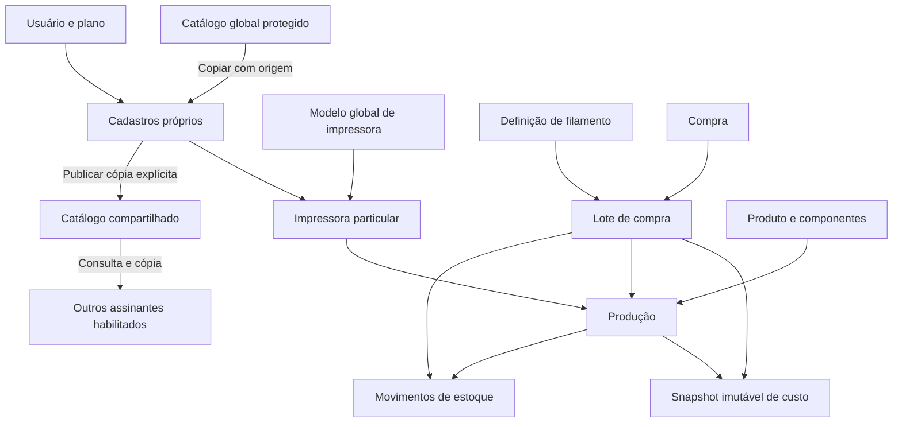

# MakerCusto — MODELO DE DADOS PROPOSTO

> **Projeto lógico, sem migrações SQL nem criação de banco.** Baseline da documentação em 20/11/2026. As cinco regras estruturais de `PLANO_MESTRE_MAKERCUSTO.md` são homologadas; nomes técnicos, campos, cardinalidades adicionais e critérios de implementação abaixo são propostas a validar.

## 1. Três camadas de cadastros — não confundir

- **Oficial global**: referência mantida pelo administrador, legível por todos os tipos de conta. Usuário nunca faz UPDATE/DELETE; cópia própria cria novo ID. Alterações administrativas com versão preservada e sem reescrever histórico.
- **Compartilhado**: publicação de cadastro próprio para leitura pelos planos Compartilhado e Full; edição apenas pelo autor ou administração autorizada; terceiros fazem cópia.
- **Privado**: registro próprio, não visível a terceiros; no Full é o padrão. Publicação voluntária gera **outro registro compartilhado**, sem expor o privado.

### Colunas comuns sugeridas para cadastros copiáveis

`id UUID PK`, `owner_id UUID NULL` (nulo somente em global), `scope ENUM(global, shared, private)`, `source_id UUID NULL` (origem da cópia), `name TEXT`, `version INTEGER`, `created_at TIMESTAMPTZ`, `updated_at TIMESTAMPTZ`, `archived_at TIMESTAMPTZ NULL`.

**Invariantes propostas**: `scope=global => owner_id IS NULL`; `scope in (shared,private) => owner_id NOT NULL`; `source_id != id`; não permitir cadeia circular de fontes; publicação compartilhada cria novo ID, preservando original; histórico em snapshot desvincula custo futuro de alteração de cadastro. Para globais, restringir escrita a serviço administrativo e versionar em vez de sobrescrever.

**Nota crítica**: nem toda entidade exige `scope`. Compras, estoque, movimentos, faturamento e dados da conta são **particulares** e não se tornam compartilháveis apenas porque o usuário publicou o modelo de filamento; os direitos de compartilhamento são sobre fichas de referência, não sobre saldos/dados financeiros.

## 2. Entidades propostas e relações

| Entidade lógica | Identificadores/campos principais | Relação e finalidade |
| --- | --- | --- |
| `profiles` | `user_id PK`, nome, preferências | Liga a identidade de autenticação |
| `subscriptions` | `id`, `user_id`, plano, status, vigência | Permissão comercial validada no servidor; alterações por serviço confiável |
| `workspaces` (futuro) | `id`, `owner_id`, nome | Possibilidade de múltiplas oficinas; não implementar antes de decisão |
| `catalog_filament_types` | id, nome, classe técnica, versão | Tipo global, compartilhado ou privado; cópia renomeável |
| `catalog_colors` | id, nome, tonalidade/código opcional | Cor global, compartilhada ou privada |
| `catalog_brands` | id, nome | Marca global, compartilhada ou privada |
| `printer_models` | id, marca_id, modelo, volume, fonte | Referência global e suas cópias; ficha técnica com proveniência |
| `printers` | id, owner_id, model_id, apelido, valor, watts, vida útil, data compra | Equipamento físico particular; pode nascer copiando ficha do modelo |
| `user_preferences` | user_id PK, last_printer_id, calc_mode | Última impressora para novo produto; visitante usa localStorage |
| `filament_definitions` | id, type_id, color_id, brand_id, descrição | Identidade do material; não é uma bobina nem preço de compra |
| `suppliers` | id, owner_id, nome, contato | Dados privados do comprador |
| `purchases` | id, owner_id, supplier_id, data, nota/ref | Documento de aquisição |
| `purchase_lines` | id, purchase_id, item_ref, quantidade, unidade, preço total | Preço histórico por item; múltiplas compras não se sobrescrevem |
| `material_lots` | id, purchase_line_id, filament_definition_id, quantidade, unidade | Bobina/lote identificado e quantidade de aquisição |
| `tools` | id, owner_id, nome, preço, vida útil, método de rateio | Ferramenta reutilizável e despesas de uso; não consumível unitário |
| `supplies` | id, owner_id, descrição, unidade | Insumos comprados: cola, argolas, ímãs, embalagem |
| `products` | id, owner_id, nome, SKU, variante, status | Produto acabado, kit ou componente fabricado |
| `product_components` | id, product_id, component_ref, quantidade, unidade, sequência | Relação de composição: impresso, comprado, ferramenta/serviço; impedir ciclos em kits |
| `production_runs` | id, owner_id, printer_id, data, tempo, status, quantidade | Execução concreta de impressão/fabricação |
| `production_outputs` | id, run_id, product_id, quantidade_boa, rejeitos | Vários produtos na mesma mesa/lote |
| `production_consumption` | id, run_id, lot_id/supply_id, quantidade, unidade, perdas | Consumo rastreável por recurso e material |
| `stock_locations` | id, owner_id, nome | Local de armazenagem, se existir |
| `stock_movements` | id, owner_id, item_ref, lot_id, location_id, tipo, qty_signed, origem, occurred_at | Ledger imutável de entradas, saídas, perdas, estornos e inventários |
| `stock_balances` (derivado) | item_ref, lot/location, quantidade | Consulta agregada baseada em movimentos; não fonte de verdade independente |
| `cost_snapshots` | id, owner_id, run_id/product_id, data, valores, fórmula_versão, origem_preço | Fotografia financeira imutável de cálculo confirmado |
| `cost_snapshot_lines` | id, snapshot_id, recurso_id, quantidade, preço_unidade, total, origem | Congela cada componente do cálculo, evitando recálculo histórico |
| `audit_events` | id, actor_id, objeto, ação, data | Trilha de alterações/compartilhamentos importantes |

**Modelagem de referência polimórfica (item_ref)**: os campos acima indicam intenção de domínio, **não esquema SQL pronto**. Antes da migração, escolher tabela-mestra `inventory_items` com chaves estrangeiras reais, ou tabelas específicas e restrições equivalentes; evitar referências UUID não verificadas sem FK. Idem para `component_ref` e `lot_id/supply_id`.

## 3. Relacionamentos-chave

- `printer_models 1:N printers`, `profiles 1:N printers`; preferência aponta uma impressora do próprio usuário.
- `purchases 1:N purchase_lines`; `filament_definitions 1:N material_lots`; um lote pertence a uma compra/linha específica.
- `products 1:N product_components`; um componente impresso pode ser outro produto e exige prevenção de recursão.
- `production_runs 1:N production_outputs` e `production_consumption`; uma execução pode gerar produtos diferentes.
- `stock_movements` registra consumo da execução e entradas de compra; `stock_balances` é projeção, não única evidência.
- `cost_snapshots 1:N cost_snapshot_lines` referencia parâmetros da época e preserva custo mesmo se rolo/preço/nome forem modificados.

## 4. Matriz de leitura e escrita preliminar

| Recurso | Visitante/Gratuito | Compartilhado pago | Full pago |
| --- | --- | --- | --- |
| Catálogo oficial global | Ler e copiar localmente | Ler e copiar para cadastro próprio | Ler e copiar para cadastro próprio |
| Original global | **Nunca editar** | **Nunca editar** | **Nunca editar** |
| Cadastro compartilhado de terceiro | Sem acesso reservado a assinantes, salvo decisão futura | Ler/copiar; não editar | Ler/copiar; não editar |
| Cadastro compartilhado próprio | Não aplicável sem assinatura | Criar, editar e inativar seus registros | Criar voluntariamente como cópia, editar o publicado |
| Cadastro Full privado | Sem acesso | Sem acesso a privado de terceiros | Criar, ler, editar e inativar apenas próprios |
| Compras/estoque/custos privados | Local apenas, sem sync prometida | Restritos a proprietário, quando habilitados | Restritos a proprietário |
| Administração de globais | Somente serviço/admin autorizado, fora dos direitos de usuário de plano | Idem | Idem |

Pendente: política de privacidade de rascunhos próprios de assinantes Compartilhado (publicação obrigatória ou opt-in), exclusões, cancelamentos e direitos administrativos.

## 5. Regras de autorização a provar em futura implementação

1. RLS em toda tabela exposta; `GRANT` mínimo e regras `USING`/`WITH CHECK` com propriedade e visibilidade. `authenticated` isolado **não é autorização**.
2. Administração de globais fora de endpoints de usuário comum. IDs de origem não permitem atualizar a referência.
3. Planos assinados são verificados por dados protegidos mantidos no servidor; nunca confiar em edição de metadados do cliente.
4. Um Full não pode consultar privado de outro Full. Um assinante Compartilhado não altera linha compartilhada alheia, mesmo via API direta.
5. Fazer POST de compartilhado sempre com cópia, exigindo consentimento explícito do dono e mantendo original privado.
6. Não conceder credenciais `service_role` nem SQL administrativo ao navegador.
7. Compras, lotes, preços, estoque e snapshots devem ter políticas de acesso próprias, mesmo quando origem do catálogo é compartilhada.
8. Testes de downgrade de plano, convite/sessão expirada, exclusão, update de `owner_id` e tentativas de IDs alheios devem ser obrigatórios.

## 6. Invariantes financeiras e de unidades

- Guardar `quantity`, `unit`, `unit_price/total_price`, moeda BRL, conversão precisa g/kg e origem da precificação.
- Escolher decimal/centavos e regras de arredondamento antes de dados financeiros persistidos; `Number` atual é aceitável apenas para protótipo.
- Preço de compra de embalagem diferente do preço por kg; lote selecionado deve resultar em custo proporcional e auditável.
- Custos de filamentos no modo total e detalhado são **mutuamente exclusivos**; perdas declaradas só entram uma vez.
- Energia por `W/1000 * horas * R$/kWh`; depreciação por `valor equipamento/vida útil * horas`; qualificar como estimativa.
- Movimentações de estoque assinadas e referenciadas por documento/execução; correções via novo movimento de estorno, mantendo histórico.
- Produto acabado pode incluir peças impressas, serviços e insumos comprados sem duplicar custo entre kit e componentes.

## 7. Plano de migrações (somente futuro)

1. Definir política de múltiplas oficinas, SKU/estoque, uploads, consentimento de compartilhamento e retenção antes de congelar esquema.
2. Preparar diagramas ER finais e migrações versionadas **em GitHub**, sem executar em ambiente real.
3. Construir testes SQL/RLS para cada matriz de acesso, incluindo leitura pública global e bloqueio de mutação, isolamento Full, autoria do compartilhado e downgrade.
4. Verificar documentação e mudanças atuais do Supabase, executar revisão de segurança e confirmar custo das opções; só então solicitar autorização de criar/provisionar banco.
5. Quando autorizado, aplicar migrações e consultar tabelas/políticas; integrar repositórios de dados no frontend, mantendo motor matemático independente.

**Neste documento não existe SQL executado, esquema provisionado, autenticação configurada ou deploy.**
