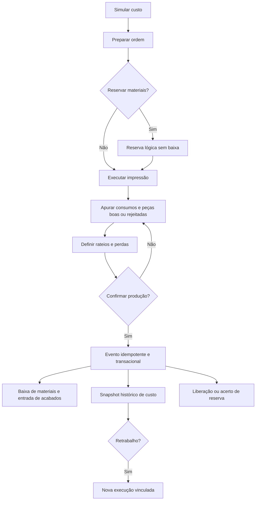

# MakerCusto — Cinco propostas para homologação de produção real

**Data:** 20/11/2026 (Brasília). **Base exata revisada:** commit `e479d08e02228dab4b2ae9cf16cf6450b263e438`, principalmente `MODELAGEM_PRODUCAO_REAL_E_RATEIO.md`, `REFINAMENTO_ESTOQUE_PRODUCAO.md`, `HOMOLOGACAO_ESTOQUE_2026-11-20.md`, `CONTINUIDADE.md` e `PADROES.md`.

**Status:** PROPOSTAS PARA HOMOLOGAÇÃO, não aprovadas. As **23 homologações** (5 estruturais, 8 permissões, 4 técnicas, 6 operacionais) continuam válidas; este documento não estabelece fórmulas/políticas como aprovadas. Não criar SQL, código, banco ou deploy.

## 1. RES — Reservas opcionais vinculadas à ordem

**Recomendação:** reserva é opcional para uso rápido e disponível em produção com estoque. Registrar `workspace_id`, ordem, `item_id`, lote/local quando escolhidos, quantidade base, estado e trilha de eventos. A reserva não cria movimento físico; consumo real só ocorre quando a produção é confirmada. Conceito proposto: `disponível = saldo físico − reservas ativas`, sem saldo negativo por padrão (esta proibição já é homologada).

**Exemplo hipotético:** bobina PETG branco com 1.000 g físicos; reservar 300 g para 20 chaveiros → 700 g disponíveis, 1.000 g físicos. Cancelar a reserva → 1.000 g disponíveis sem nova entrada de compra. Confirmar consumo de 280 g → físico 720 g e liberar/consumir reserva de 280 g no mesmo evento; os 20 g restantes continuam reservados ou são liberados conforme política de encerramento a definir.

**Proposta complementar:** reserva nunca produz baixa automática ao vencer. Prazos/expiração, múltiplas ordens, troca de rolo, reserva de kits, revalidação concorrente e liberação de sobras ainda não homologados.

**Aceite futuro:** duas ordens não reservam simultaneamente mais que disponível; cancelamento não altera físico; confirmação não desconta reserva e físico duas vezes.

## 2. PAR — Confirmações incrementais da produção

**Recomendação:** uma mesa/execução pode ter várias confirmações **incrementais**, cada qual com `confirmation_id`, chave idempotente, autoria, consumo novo, saídas boas/refugadas novas e custo histórico. Só confirmar pode baixar, preservando regra homologada. A soma confirmada não pode exceder o consumo/saídas reais da execução.

**Exemplo hipotético:** execução produz corpos em duas etapas. Primeiro confirma 50 g consumidos e 5 corpos bons; depois mais 20 g e 2 corpos bons. Total confirmado = 70 g e 7 unidades, não 120 g. Reenvio do primeiro evento retorna o mesmo resultado, sem nova baixa.

**Atenção:** quando a impressora interrompe com filamento já gasto, o registro de consumo só será contabilizado na confirmação, inclusive se a operação terminar com zero peças boas. Preparar, iniciar, pausar ou simular não baixa estoque.

**Ainda aberto:** se a tela do MVP terá somente confirmação final, embora a estrutura permita várias; maneira de reconciliar medição incremental, excedentes e encerramento definitivo.

## 3. FAL — Falha com consumo real e perda explícita

**Recomendação:** aceitar confirmação de produção com `good_qty=0`, desde que o usuário informe consumo/tempo reais ou estimados (proveniência obrigatória); contabilizar material efetivamente consumido e não gerar produto acabado fictício. Prejuízo de falha é categoria própria. Não transferir automaticamente toda perda para peças boas ou chamá-la de custo por unidade vendável sem regra comercial futura.

**Exemplo hipotético:** impressão deveria produzir 10 suportes, consumiu 80 g de PETG e falhou; confirmada a falha, baixa 80 g, registra energia/máquina/tempo consumidos (quando informados), entrada de acabados = 0. A moeda e valores monetários são calculados segundo preço real do lote/hipóteses explicitadas.

**Falha parcial:** 7 suportes bons e 3 rejeitados → saídas separadas; consumo total e custo da perda classificados antes de eventual rateio.

**Pausas:** guardar tempo ativo, pausado e decorrido separadamente; não inferir gasto elétrico real apenas da duração de relógio. Definir contabilização de ociosidade antes de SQL.

**Ainda aberto:** incorporação de perda aos preços futuros, classificação de descarte/recuperação, decisão de quem confirma falhas e regras de estorno.

## 4. RET — Retrabalho como nova execução vinculada

**Recomendação:** retrabalho recebe registro e custo próprios vinculados à impressão/saída original. Registra material adicional, ferramentas, tempo de montagem/reimpressão, resultado (recuperada, rejeitada etc.) e novo snapshot; o custo histórico original permanece intacto. Somente sua confirmação gera movimento.

**Exemplo hipotético:** 1 peça precisa de 15 minutos adicionais de acabamento; acrescentar custo de mão de obra/insumos efetivamente aplicados à operação de retrabalho, sem editar o snapshot da impressão original. Se envolver nova impressão de parte, contabilizar filamento usado em confirmação separada.

**Ainda aberto:** se custo de retrabalho deve integrar o valor contábil do produto acabado ou aparecer separado apenas para análise; devoluções, reimpressão completa e vínculo a unidade individual/SKU.

## 5. RAT — Rateio categorizado, rastreável e reconciliado

**Recomendação:** cada custo da mesa integra um único grupo (`cost_pool`) e é alocado a saídas boas, perdas ou retrabalhos por linhas com `basis`, `quantity`, `allocated_amount` e `reason`. Grupos: filamento de modelo, purga, perdas, energia, depreciação, montagem, acessórios e ferramentas. A fórmula para cada categoria deve ter prioridade em **medição direta**, e quando isso não existir permitir escolha explícita de base: tempo atribuível, massa compatível, medição estimada ou distribuição manual justificada. Não escolher uma base automática para tudo.

**Exemplo ilustrativo (sem medição):** mesa com 30 corpos e 10 suportes, energia total estimada R$ 6,00. Se o maker declarar tempo atribuído de 75% aos corpos e 25% aos suportes, alocar R$ 4,50 e R$ 1,50, totalizando R$ 6,00. **Isso não torna 75/25 um padrão obrigatório nem autoriza rateio por quantidade 30/10 sem informação.**

**Filamento:** o que for diretamente identificável é imputado por tipo/cor/lote à saída que o consumiu. Purga adicional só entra se não constar no consumo informado; purga compartilhada exige critério explícito por material/saída. Peças refugo recebem classificação de perdas e não devem desaparecer do custo da mesa.

**Conciliação:** para cada grupo, `soma(alocações) == custo do grupo` após regra de precisão ainda a definir; confirmação não pode deixar custo inexplicado ou duplicado. A regra homologada de rateio explícito fica preservada, mas **nenhuma fórmula específica está homologada**.

**Ainda aberto:** política de arredondamento de centavos, rateio de energia durante pausa, origem real/estimada de tempo, custos de falha incorporados à peça boa e direção comercial do rateio.

## 6. Fluxo consolidado proposto

**Obrigatório nas próximas versões:** implementação futura não deve trocar propriedades de catálogos globais, expor dados financeiros ao compartilhado, permitir saldo negativo ordinário ou baixar ao abrir a ordem. Esses pontos já foram homologados e não são alternativas.

## 7. Matriz de decisão para o proprietário — PENDENTE

| ID | Recomendação para aprovar | Exceções/detalhes que permanecem abertos |
|---|---|---|
| RES | Reservas opcionais, não físicas, saldo disponível desconta reservas | expiração, cancelamento de parte, troca de lote e política de sobras |
| PAR | Confirmação incremental idempotente por execução | UX final do MVP e reconciliação entre parciais |
| FAL | Falha contabiliza consumo/tempo com zero produto bom e perda separada | repasse financeiro a produtos futuros, aproveitamento/refugo |
| RET | Retrabalho separado e vinculado, sem reescrever snapshot anterior | incorporação ao valor do acabado |
| RAT | Rateio por grupo de custo: direto quando medível, senão base explícita, 100% conciliado | fórmula específica por categoria, centavos, pausas, precificação de perdas |

A aprovação dessas cinco recomendações, se ocorrer futuramente, **não** decidirá automaticamente as colunas de exceções ou autorizará migrações.

## 8. Cenários de aceite FUTUROS (não executados)

1. Reservar 300 g de 1 kg: físico 1 kg, disponível 700 g; cancelar volta disponível a 1 kg sem movimento físico.
2. Confirmação de consumo de 280 g com reserva 300 g: saldo físico 720 g, liberação/reserva restante conforme opção homologada mais tarde.
3. Duas confirmações de 50 g e 20 g: total 70 g; repetição idempotente não altera total.
4. Falha de 80 g e zero bons: baixa 80 g apenas ao confirmar, zero entrada de acabados.
5. Retrabalho de 15 min: novo snapshot de custo, original imutável.
6. Mesa com corpos e suportes: cada pool de energia/filamento/perdas totalmente alocado com `basis` visível e rastreável, sem duplicação.
7. Duas confirmações simultâneas que estourariam saldo: impedir saldo negativo por validação concorrente.
8. RLS: oficina A não consulta reserva, custo ou estoque B mesmo usando ficha de material compartilhada.

**Resultado:** documento de proposta para homologação, sem testes executados, código alterado, SQL, banco, merge ou deploy.
