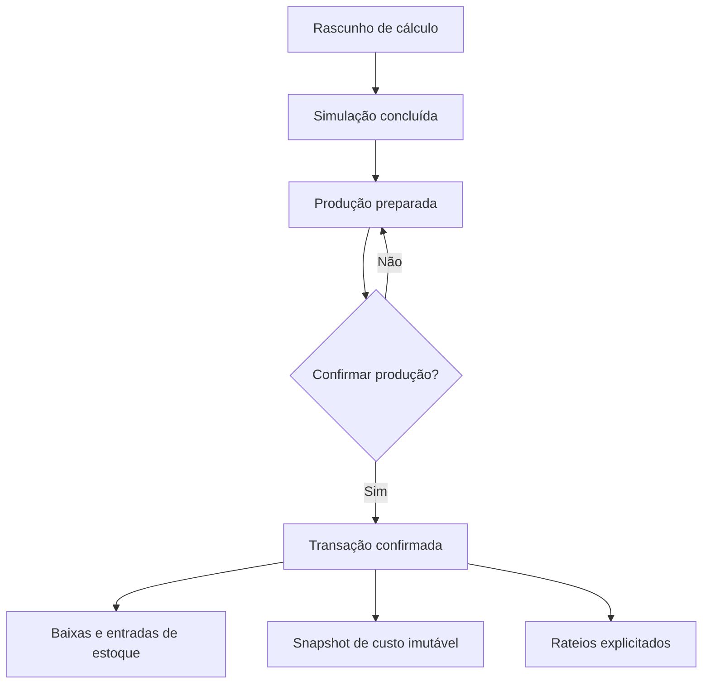

# MakerCusto — refinamento lógico de estoque, produção e composição

**Base:** commit `7d7507cc`, `CONTRATO_ESTOQUE_PRODUTOS.md` e homologação operacional de 20/11/2026. **Status:** refinamentos PROPOSTOS, não homologados automaticamente. As seis regras homologadas estão em `HOMOLOGACAO_ESTOQUE_2026-11-20.md`.

## 1. Modelo relacional preferencial — PROPOSTO

| Entidade | Identidade/relações propostas | Responsabilidade |
|---|---|---|
| `workspaces` | `id`, `owner_user_id` | fronteira proprietária |
| `inventory_items` | `id`, `workspace_id`, `kind`, `base_unit`, `active` | identidade de estoque por oficina, não ficha compartilhável |
| `inventory_filaments` | `inventory_item_id PK/FK`, `filament_specification_id FK` | liga item estocável a definição de filamento sem duplicar compras |
| `inventory_purchased_components` | `inventory_item_id PK/FK`, `descriptive_reference_id? FK` | acessórios/insumos comprados |
| `inventory_finished_products` | `inventory_item_id PK/FK`, `product_id FK` | produto acabado fabricado |
| `stock_locations` | `id`, `workspace_id` | local físico |
| `purchases` / `purchase_lines` | IDs, `workspace_id`, `inventory_item_id`, valores e unidades | preço original de aquisição e rastreabilidade |
| `stock_lots` | `id`, `workspace_id`, `inventory_item_id`, `purchase_line_id?` | lote ou bobina particular sem saldo editável |
| `stock_events` | `id`, `workspace_id`, `idempotency_key`, `source_kind`, `source_id`, `status` | operação lógica única, pode produzir vários movimentos |
| `stock_movements` | `id`, `stock_event_id FK`, `workspace_id`, `inventory_item_id`, `lot_id?`, `location_id?`, `delta_base`, `reverses_id?` | ledger imutável |
| `products` / `product_revisions` | IDs e FK entre produto e revisão | ficha e composição versionada |
| `product_components` | `revision_id`, uma FK alvo conforme `component_kind`, `quantity_base` | materiais, peças, ferramentas ou serviços |
| `production_runs` | `id`, `workspace_id`, `printer_instance_id`, `status` | execução/impressão |
| `production_outputs` | `run_id`, `product_revision_id`, `good_qty`, `reject_qty` | resultados distintos na mesa |
| `production_consumption` | `run_id`, `inventory_item_id`, `lot_id?`, `model_qty`, `purge_qty`, `waste_qty` | consumo por lote, sem duplicação |
| `production_allocation_lines` | `run_id`, `output_id`, `cost_category`, `allocation_basis`, `share`, `amount` | rateio declarado por saída |
| `cost_snapshots` / `cost_snapshot_lines` | `run_id`, `product_revision_id`, `formula_version`, preços/fontes | custo confirmado imutável |

**Atenção:** são nomes lógicos, não SQL pronto. `inventory_items` com subtipos é recomendação ainda pendente. Para evitar FK polimórfica insegura, cada subtipo deve ter relação 1:1 verificável e restrições do tipo do item. `stock_events.idempotency_key` é proposto para representar a **operação inteira**, não para proibir indevidamente as duas pernas da mesma transferência. Chaves e tipos finais dependem de migrações aprovadas.

## 2. Máquina de estados da produção — PROPOSTA

- **Já homologado:** simular, editar e preparar **não** baixa estoque. Confirmar produção efetiva a baixa; correção é estorno novo.
- **Proposta adicional:** autorização de confirmação valida `workspace_id`, revisão BOM congelada, origem/lote dos materiais, saldos e rateio. Aplicar mudanças de estoque e snapshot juntos, de modo transacional/idempotente; ou tudo é confirmado, ou nada.
- **Aberto:** produção parcial, confirmação após falha, cancelamento posterior, ajuste de consumo real estimado, estoque de produtos intermediários, reprocessamento do mesmo evento e versões de ordem de produção.

## 3. Controle do saldo por lote e local — PROPOSTA

`physical_balance(item, lot, location) = SUM(stock_movements.delta_base)` contabilizados. Disponibilidade a definir se existir reserva; **não presumir que saldo disponível = físico − reservas** até decidir política de reservas.

Antes de confirmar uma baixa: agrupar os movimentos negativos efetivos por item/lote/local dentro da transação, ler saldo de maneira concorrente segura e rejeitar resultado negativo por padrão. Ajustes justificáveis, inventário e estornos devem passar por regras de consistência próprias. Estorno de uma compra já consumida pode criar conflito de saldo — **não aceitar reversão cega**.

Transfêrencia de local deve gerar duas linhas no mesmo `stock_event`, de valores opostos, verificando saldo de origem e mesmo item/lote. O total da oficina permanece igual. Compra que gera múltiplas bobinas não pode criar saldo duplicado em `filament_lots` e `stock_lots`.

## 4. Composição por revisão — PROPOSTA

- `product_revisions` guarda identidade de receita; linhas `product_components` pertencem à revisão, não ao produto mutável.
- Cada linha usa exatamente um alvo: produto componente fabricado, `inventory_item` consumível, uso de ferramenta reutilizável ou serviço de montagem; rejeitar referências cruzadas e ciclos de kits (`A→B→A`).
- Nova versão não substitui composição usada em produção anterior. **Proposta:** a produção confirmada referencia o ID da revisão e os custos reais são congelados no snapshot.
- As linhas de ferramenta/serviço **não** geram baixa automática de ferramenta. Componentes comprados geram consumo, se houver produção confirmada e política aplicável.
- Separar a quantidade de partes por unidade do kit da quantidade impressa por mesa para evitar multiplicações erradas.

## 5. Rateio de mesa mista — contrato sem impor fórmula

O critério de **rateio explícito** está homologado, mas a fórmula não. Para cada `production_run` com diferentes saídas, a proposta é gravar:
- Cada produto/peça e quantidade boa/refugada com revisão.
- Categorias de custo alocáveis (tempo de máquina, energia, filamento/modelo, purga, perdas e uso de ferramenta), com base declarada e unidade.
- `allocation_basis` (p.ex. tempo real atribuído, peso, contagem, intervenção manual) é **opção futura**, não default aprovado.
- Somatório das quotas de cada categoria deve equivaler ao custo da categoria, sem sobras/duplicação. Registrar distribuição e justificativa; resíduos de arredondamento devem ser atribuídos com política definida.
- Não permitir distribuir custo de filamento de cor X a produto Y de maneira incompatível sem rastreabilidade ou ajuste explícito.

**Exemplo para teste (não é regra aprovada):** uma mesa imprime 30 corpos e 10 suportes; custos diferentes por material/tempo devem ser atribuídos às saídas em linhas próprias. Não dividir tudo por 40 simplesmente.

## 6. Estorno e auditoria — PROPOSTA

- `stock_events` agrupa movimentos e registra ator, origem, momento e chave de idempotência. Estorno gera **novo evento** com referência à operação original, sem apagar linhas confirmadas.
- Estorno total corresponde à inversão das linhas contabilizadas que são elegíveis; estorno parcial e aprovação por operador permanecem abertos.
- O evento de produção e seus snapshots confirmados não são apagados por estorno: registrar documento de retificação e relação com o original, para fins históricos.
- Testar conflito de estorno com saldo já consumido; não criar saldo negativo automaticamente.

## 7. Regras de acesso para futura política RLS

- Toda entidade operacional tem `workspace_id`; usuário de oficina A não pode ler/escrever itens, lotes, estoque, revisões particulares, produção, rateios ou snapshots de B.
- Dados de estoque não herdam visibilidade de `filament_specifications` compartilhada: referências descritivas e dados financeiros são domínios diferentes.
- `source_event_id`, `workspace_id`, `owner_id`, status confirmado e valores de snapshot não podem ser alterados livremente pelo cliente. Controle no serviço com políticas RLS e invariantes transacionais.
- Equipes, convites e direitos de terceiros continuam **não homologados**.

## 8. Critérios de teste futuros (NÃO executados)

| ID | Cenário | Resultado esperado |
|---|---|---|
| EST-11 | Baixa de 101 g com saldo de 100 g | Rejeitar; nenhum movimento parcial |
| EST-12 | Repetir confirmação com a mesma chave idempotente | Uma confirmação, um conjunto de movimentos/snapshot |
| EST-13 | Simulação calcula 120 g sem confirmar | Estoque inalterado |
| EST-14 | Confirmação de produção com material disponível | Saída registrada, produto acabado entra conforme política |
| EST-15 | Estorno de operação confirmada | Evento compensatório vinculado e original preservado |
| EST-16 | Estorno que geraria saldo negativo por consumo posterior | Não executar cegamente; exigir resolução compatível |
| PROD-11 | Produto muda composição após produção | Snapshot/revisão da produção anterior inalterados |
| PROD-12 | Kit inclui argola, peça impressa, montagem e ferramenta | Custo separado; ferramenta não consumida |
| RATE-11 | Mesa com dois produtos e custos alocados | Conciliação de alocações por categoria, sem dupla contagem |
| SEC-11 | Assinante compartilhado tenta ler estoque do autor | Negado; ficha descritiva compartilhada permanece permitida |

## 9. Bloqueadores antes de SQL

Resolver, separadamente, política de reservas e saldo disponível, lote não identificado, custo da falha/retrabalho, escolha de fórmula de rateio, congelamento de BOM, controle de simultaneidade, regras de estorno parcial e precisão monetária. Registrar decisões com a mesma disciplina de homologação já adotada. Nenhum SQL ou operação no Supabase faz parte desta entrega.
